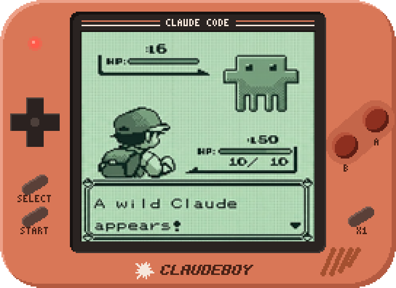
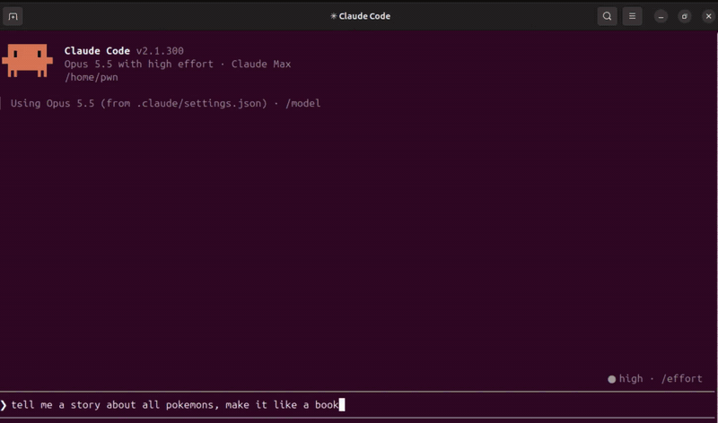

<h1 align="center">ClaudeBoy</h1>

<p align="center">
  
</p>

A Claude Code mod that drops you into a Game Boy game while Claude works, and
hands you back when it's done. Everything runs on your machine: the emulator is
[mGBA](https://mgba.io)'s Game Boy core in a small process of its own, and there's
no server or account.

When Claude has been working for two seconds, a pane opens with your game,
right where you left it: beside the transcript in fullscreen, above the
prompt otherwise. When Claude finishes, a three-second countdown runs on the
game's screen, then the game pauses, **saves itself**, and you're handed
back. Press Esc during the countdown to stay in the game; press Esc again
when you're ready to go back to Claude. If Claude needs you, for a permission
prompt or a question, you're handed back at once and dropped in again after
you answer. In auto mode the classifier answers most prompts, so play goes on
through those. (Where an organization manages Claude Code's settings,
permission prompts may not hand you back.)

Any Game Boy or Game Boy Color game works (`.gb`, `.gbc`). You open the ones
you own, and ClaudeBoy keeps them in a game library to switch between, each
with its own saves. Super Game Boy games play in their Super Game Boy colors.
It was built against Pokémon Yellow.

## Setup

ClaudeBoy runs on Linux only, for now. It was made with Claude Code 2.1.300.

1. Get it and build the emulator, once. The build fetches mGBA 0.10.5's
   source (about 14 MB, checked against its checksum) and needs `cmake`,
   `make`, a C compiler (`cc`), `tar`, `flock` and `curl`. On Ubuntu or
   Debian: `sudo apt install build-essential cmake curl`.

   ```
   git clone https://github.com/nedlir/ClaudeBoy
   cd ClaudeBoy
   ./scripts/build.sh
   ```

   `/claudeboy` runs the build for you if you skip it, and runs it again
   when the emulator's source changes, as after a `git pull`.

2. Load the mod. To try it for one session:

   ```
   claude --plugin-dir path/to/ClaudeBoy
   ```

   To keep it, install it from that folder (should Claude Code run a copy
   of it, `/claudeboy` builds the emulator there the first time):

   ```
   claude plugin marketplace add path/to/ClaudeBoy
   claude plugin install claudeboy@claudeboy
   ```

3. Turn it on with `/claudeboy`. The first time, it asks for a game: pick one
   it found in your Downloads, Desktop, Documents or Games folder, your home
   folder, `~/roms`, the ClaudeBoy folder or its `roms`, or type or paste
   the path to a `.gb` or `.gbc` file. `/claudeboy off` turns it off again.
   With `--plugin-dir`, `/reload-plugins` picks up an edit to `hooks/`.

## Playing

Click the game to give it the keys: the picture in the pane, or the console.
On the console, Esc hands you back to Claude. In the pane, Esc first gives
the keys back to the prompt, so you can type to Claude while the game stays
up, and Esc again closes it. During the countdown, Esc keeps you playing.

| Game Boy | Key |
| :- | :- |
| D-pad | arrow keys |
| A | Z |
| B | X |
| Start | Enter |
| Select | Shift (or Backspace) |

ClaudeBoy's own keys show under the game, a few to a row:

| ClaudeBoy | Key |
| :- | :- |
| Save to a slot | S, then 1–9 |
| Load a slot | L, then 1–9 |
| Open another game | O |
| Switch to a game from your game library | G, then 1–9 or the arrows and Enter |
| Sound on or off | M (off at first) |
| Speed ×1, ×2, ×4 | F |
| Exit, back to Claude | Esc |

The game pauses while O or G is open, and Esc goes back to it. Shift for
Select works on the console; terminals don't report Shift alone, so when the
game is in the pane, Select is Backspace.

Outside kitty and Ghostty, on a desktop, the game plays on a Game Boy in
Claude's orange, drawn in pixel art: its D-pad, A, B, Select and Start light
up and press in as you hold them, and a third button beside them shows the
speed. You can also click them: hold the mouse on one to hold it, and click
the speed button to step the speed as F does.

The game's window sees keys as any game does. Terminals, though, report key
presses but not releases, so in the pane a lone press is a short tap, and a
held key counts as held for as long as its auto-repeat keeps coming. In
games like Pokémon a tap takes one step and holding walks, with a short stop
after the first step while the repeat starts. Shortening your keyboard's repeat
delay in your desktop's settings shortens that stop.

## Saves

- **Autosave.** The game is saved whenever it pauses: each time you're handed
  back, when you close the pane, and when the session ends. It's also saved
  every two minutes of play. The next drop-in picks up exactly there.
- **Slots.** Nine save states per game: S or L in the game, or
  `/claudeboy save <1-9>`, `/claudeboy load <1-9>` and `/claudeboy slots` from
  the prompt, which work while Claude is idle too. A slot holds the whole
  game, its in-game save included, so loading one brings everything back as
  it was.
- **In-game saves** go to a regular battery save that other emulators read.

Everything lives in `~/.local/share/claudeboy/saves/<game>/` (or under
`$XDG_DATA_HOME/claudeboy` when that's set), where `<game>` is the game's
title and a checksum, like `pokemon-yellow-7d527d62`
(`dist/claudeboy-engine info <rom>` prints it as `key`): `battery.sav`,
`auto.state` and `slot1.state` to `slot9.state`. To bring a save from another
emulator, put its `.sav` there as `battery.sav` and delete `auto.state`, if
there is one: an autosave carries the in-game save it was made with, and
loading it writes that back. Set `CLAUDEBOY_DATA_DIR` to use another folder
in place of `~/.local/share/claudeboy`.

Your game library remembers where each game's file is, and the files stay
where they are. If you move one, open it again from its new place with O; its
saves carry over, since they follow the game, not the file.

One session at a time plays a given game. When another session has it, the
pane asks "Would you like to play it here?": 1 or Enter on Yes, 0 or Enter on
No, or move between them with the arrows. Yes takes it: the other session
saves and lets go at once, and says where the game went. No stays out for the
rest of the turn.

## Where the game shows

- **In kitty or Ghostty:** right in the pane beside the transcript, as a real
  picture rendered at exactly the size the terminal shows it, so every pixel
  is sharp. It fills the pane at the Game Boy screen's shape and follows the
  pane and the terminal as they resize or change font.
- **In any other terminal on a desktop** (GNOME Terminal, Konsole, Alacritty
  and the rest), ClaudeBoy draws the console itself, on top of Claude's side
  pane. When the terminal is maximized, it works out where the pane is on
  screen from the desktop's work area and the terminal's grid of cells. It
  lays the console over the pane's body, cut to its rounded outline, while
  Claude Code draws the pane's frame and status lines in the terminal's own
  font. It's drawn at a whole-number scale, so every pixel stays sharp. The
  pane asks for the width the console needs at twice its size, though a
  width you've dragged it to wins. When the
  terminal isn't maximized its place can't be known, because Wayland doesn't
  say where windows are. Then the console slides out in a drawer at the right
  edge of the screen, and the pane opens at the same width so the transcript
  moves aside. Either way it fades in and out with the turn, and Esc hands
  back early. Click the console if it doesn't take the keyboard by itself.
  It uses X11, or XWayland on Wayland desktops, loaded only when needed.
  It shows only while the terminal tab holding the session is in front.
  Switch to another app or another tab and it goes at once; come back and it
  returns, leaving the keyboard where it was. ClaudeBoy learns this from the
  desktop's accessibility bus (AT-SPI), which GNOME Terminal, Konsole and
  most terminals report to. It recognizes its own tab by a short id the pane
  draws under the console. Without the bus, the console stays above other
  windows while it's out.
- **With no desktop**, as over SSH: in the pane, drawn with colored
  half-block characters, two pixels per cell. Small panes look blocky.

`/claudeboy display auto|cells|image|window` overrides the choice (pictures,
text, or the console; `auto` picks as above), and
`CLAUDE_CODE_FORCE_TERMINAL_IMAGES=1` tells Claude Code to send pictures to a
terminal it doesn't recognize. kitty is one install away on Ubuntu:
`sudo apt install kitty`. tmux passes no pictures through: inside it the
game plays on the console or in text instead.

## Commands

```
/claudeboy              turn it on
/claudeboy off          turn it off
/claudeboy play         play now, whether or not Claude is working
/claudeboy save <1-9>   save to a slot
/claudeboy load <1-9>   load a slot
/claudeboy slots        list the slots
/claudeboy open [path]  open a game (.gb, .gbc); without a path, pick one
/claudeboy games [n]    list your game library, or play game n
/claudeboy sound on|off
/claudeboy display auto|cells|image|window
/claudeboy help         list these
```

## How it works

`hooks/register.tsx` is the mod. It follows the turn (start, completion,
permission prompts), opens the pane, and starts the engine. The engine,
`engine/claudeboy-engine.c`, runs the game at the Game Boy's 59.7 frames a
second. Every frame it reads a one-line control file the mod rewrites (play or
pause, held buttons, the picture's size, commands), and it reports on stdout.
Each frame goes to a file in `$XDG_RUNTIME_DIR` (or `$TMPDIR`) as the cells of
a `Raster`, or in kitty and Ghostty into shared memory for an `Image`,
rendered at the box's size in pixels. The mod paints it in place. The engine
also reads the terminal's size, in pixels too where the terminal reports it,
so the mod can refit the picture whenever the terminal changes.
`hooks/gamepad.tsx` runs over the picture and turns key presses into held
buttons. Other terminals get the engine's own window (`engine/window.c`) with
the console drawn around the game (`engine/console.c`), shown only while the
session's terminal tab is in front (`engine/frontmost.c`, which asks the
desktop's accessibility bus). The engine loads
`libX11` the first time the window opens and reads the buttons straight from
the window. Keys that aren't the Game Boy's, like S, L, O, G, M and F, go up
to the mod, which sends back the window's title. Sound, when on, is played
through `aplay`, `pacat` or `ffplay`.

The engine can also be run by hand:

```
dist/claudeboy-engine info <rom>
dist/claudeboy-engine script <rom> <saves> <out> 600 tap:start 120 shot:intro
```

`script` runs the game as fast as it can and writes each `shot:` as a
`.ppm` picture in `<out>`; run the engine with no arguments for every step it
knows. It takes no lock on the saves, so give it a `<saves>` folder of its
own, not one a session plays from.

## Development

```
claude plugin validate .
claude plugin test .
```

The tests (about two minutes) run the mod against a stand-in for Claude Code
and a fake engine; they need no build.
Type checking in an editor needs `.claude-plugin/types/`, which Claude Code
writes there once it has loaded the mod.

## Licenses

mGBA is MPL-2.0. Its source is fetched by `scripts/build.sh` and built into
`dist/claudeboy-engine`. ROMs aren't included. Use games you own.

## Demo

ClaudeBoy at play while Claude works, at twice the speed:

<p align="center">
  
</p>
